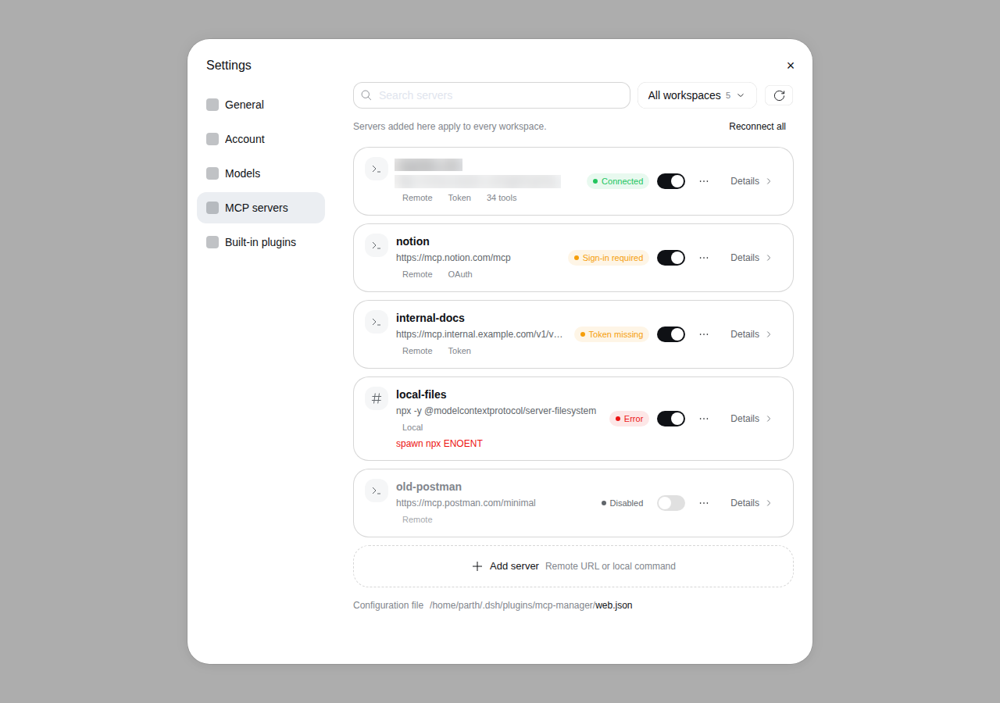

# MCP servers for DeepSeek Harness

Connect external MCP servers from the Host, scope them to a profile or a workspace, and manage them from Settings.

## What it does

- Discovers tools over stdio and Streamable HTTP and registers them as `mcp__<server>__<tool>`.
- Two scopes. Profile servers come from `$DSH_HOME/plugins/mcp-manager/<profile>.json`; workspace servers come from `<workspace>/.dsh/mcp.json`.
- A workspace entry shadows a profile entry with the same name, and `disableProfileServers` hides inherited servers for that workspace only.
- Tools register in each Agent's scope, so a workspace's servers never appear in another workspace's sessions.
- Bearer tokens come from the credentials store: an environment-style reference in the `Authorization` header, or a stored record.
- A Settings section lists every server with its status, tools, resources, prompts, instructions, and recent activity, and adds, edits, enables, disables, and deletes servers in either scope.
- OAuth sign-in opens a browser tab, uses PKCE and dynamic client registration, refreshes tokens, and falls back to a pasted redirect URL when the browser cannot reach the loopback callback.
- Bearer tokens can be pasted in the page after saving a server; the value is stored in the credentials store and never returned to the page.
- Per-server `toolPolicy` allows and denies tools by wildcard (`get*`).

## Screenshots

These renders come from the plugin's visual harness, which mounts the real page and CSS with host token values. The list, editor, mobile layout, and dark empty state.




## Install

```bash
npm install
npm run bundle
```

Then install the bundle from this directory with the plugin manager and reload the page. The profile links this directory, so `node_modules/` here serves the Host half; the MCP SDK stays external.

## Configuration

Files are written in the `mcpServers` shape used by Claude, Cursor, and Claude Desktop, so a server entry can be copied in either direction. Plugin-only settings live under a top-level `dsh` key that other clients ignore.

Profile file: `$DSH_HOME/plugins/mcp-manager/<profile>.json`. It is created with mode 0600 on the first save.

```json
{
  "mcpServers": {
    "enacton-crm": {
      "type": "http",
      "url": "https://crmai.enacton.com/api/mcp/mcp",
      "headers": { "Authorization": "Bearer ${ENACTON_MCP_TOKEN}" }
    },
    "local-files": {
      "command": "npx",
      "args": ["-y", "@modelcontextprotocol/server-filesystem", "/home/parth/Projects"]
    },
    "notion": {
      "type": "http",
      "url": "https://mcp.notion.com/mcp"
    }
  },
  "dsh": {
    "toolPolicy": { "enacton-crm": { "allow": ["crm_*"], "deny": ["crm_delete_*"] } },
    "timeouts": { "enacton-crm": { "connectMs": 15000 } }
  }
}
```

Workspace file: `<workspace>/.dsh/mcp.json`, committed with the repository. It holds no secrets.

```json
{
  "mcpServers": {
    "stripe": {
      "command": "npx",
      "args": ["-y", "@stripe/mcp", "--tools=all"]
    }
  },
  "dsh": {
    "disableProfileServers": ["notion"]
  }
}
```

Local entries use `command` plus `args`. A command array such as `["npx", "-y", "pkg"]` and `environment` are accepted too. Remote entries use `type: "http"` or a bare `url`. `sse` is not supported and reports the server name.

Other shapes are read and normalized:

- `mcpServers` (Claude, Cursor, Claude Desktop)
- `mcp.servers` with `type: local|remote` (OpenCode V2)
- a flat `mcp` map (OpenCode V1)
- `servers` with `type: stdio|http` (VS Code)

Writes always use the `mcpServers` shape.

`disabled: true` or `enabled: false` keeps a server configured without connecting it. `dsh.auth` holds `none` and `oauth` details that the standard shape cannot express; a bearer token is carried by the `Authorization` header reference.

Environment references use `${NAME}`, `${NAME:-default}`, or `{env:NAME}`. The credential store is checked first, then the process environment. The page writes the reference, never the token.

`toolPolicy.allow` and `toolPolicy.deny` accept exact names or wildcards. Deny wins; an empty allow list means all tools.

## Status

`Connected`, `Connecting`, `Configured`, `Sign-in required`, `Token missing`, `Error`, and `Disabled` are visible in the page. The page polls every two seconds while mounted. Failed connections retry with bounded backoff and never block Host startup or a session.

## Security

- Tokens live in the credentials store, never in either JSON file and never in RPC responses.
- Stdio children receive the scrubbed parent environment plus the entry's `env`.
- OAuth uses a loopback callback on `127.0.0.1`, PKCE S256, and a single-use state that expires after three minutes. A pasted redirect URL is validated against the same state.
- Signing out deletes the grant. A rejected refresh moves the row back to `Sign-in required` and removes its tools.
- Headers and environment values are configuration, not credentials; use the token field for secrets.

## Commands

```bash
npm run bundle     # write lib/host.js and lib/client.js
npm run typecheck  # tsc --noEmit
npm test           # bundle, typecheck, node --test
```

## Test manually

1. Install and open Settings, section MCP servers.
2. Add a streamable HTTP server with a URL and a token. Confirm the row reaches `Connected`.
3. Expand the row, save a token, and confirm the tools appear.
4. Add an OAuth server, click Sign in, finish in the browser, and confirm the row reaches `Connected`.
5. Start a session and call one tool.
6. Add a workspace server in another repository and confirm it appears only there.
7. Restart DSH and confirm connection state and OAuth grants survive.